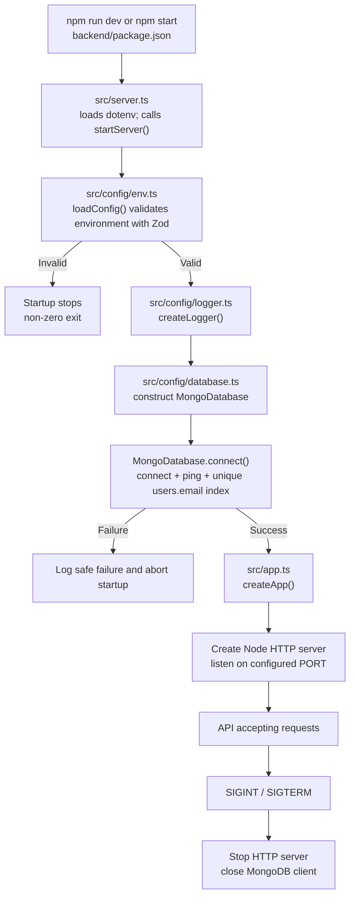
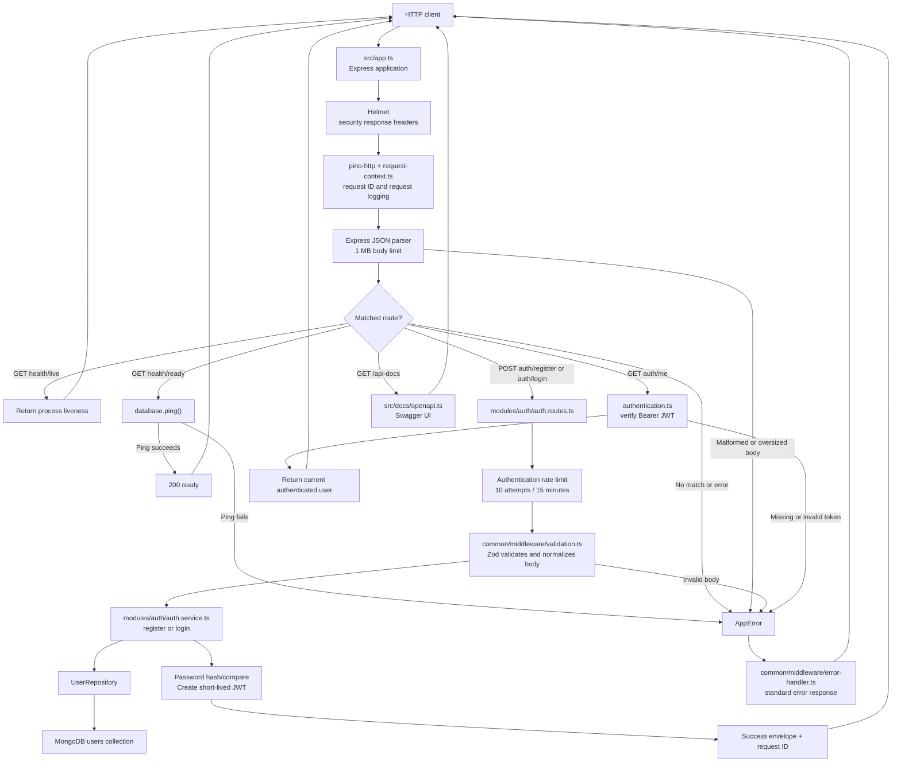

# Phase 3 Backend Walkthrough

This guide explains the backend as it exists now: how the process starts, how an HTTP request moves through the code, what each file is responsible for, and which APIs are available. It covers the Phase 3 foundation only; it does not describe planned code as if it were already implemented.

## 1. Start here

The process entry point is [`src/server.ts`](src/server.ts). From the `backend` folder:

```powershell
npm run dev
```

For a compiled run:

```powershell
npm run build
npm start
```

Before starting, copy `.env.example` to `.env` and replace `JWT_SECRET` with a private random secret that is at least 32 characters long. MongoDB must be running and reachable. Invalid configuration or a failed MongoDB startup connection prevents the server from listening.

## 2. Startup path



### Startup details

1. `dotenv/config` loads local `.env` values.
2. `loadConfig()` checks required values and bounds such as the port, MongoDB URI, JWT secret, and token lifetime.
3. `createLogger()` creates the structured Pino logger with sensitive-field redaction.
4. `MongoDatabase.connect()` connects, pings MongoDB, and creates a unique index on user email.
5. Only after the database is ready does `createApp()` assemble the HTTP application and the server begin listening.
6. Shutdown signals close the HTTP server and database client.

## 3. HTTP request path



The normal API response shape is `{ success, data, requestId }`. Errors use `{ success: false, error: { code, message, details, requestId } }`. Request IDs are returned in both the response body and the `X-Request-Id` header.

## 4. Implemented HTTP APIs

| Method and path | What it does | Important behavior |
|---|---|---|
| `GET /api/v1/health/live` | Confirms the process is running. | Does not depend on MongoDB. |
| `GET /api/v1/health/ready` | Checks whether MongoDB can be reached. | Pings the database; responds `503 SERVICE_UNAVAILABLE` when the check fails. |
| `POST /api/v1/auth/register` | Creates a standard user account. | Requires valid email and a 12–128 character password. Always assigns `user`; never accepts elevated roles from the request. |
| `POST /api/v1/auth/login` | Checks credentials and issues an access token. | Returns a short-lived JWT; invalid credentials receive a generic `401`. |
| `GET /api/v1/auth/me` | Returns the current authenticated user. | Requires `Authorization: Bearer <token>`. |
| `GET /api-docs` | Serves the Swagger UI. | Describes the Phase 3 health and authentication endpoints. |

The current endpoint contracts are also summarized in [`../docs/api/API-Specification.md`](../docs/api/API-Specification.md).

## 5. File map: where to read next

### Process and application composition

| File | Main responsibility |
|---|---|
| [`src/server.ts`](src/server.ts) | Actual process entry point. Loads config, connects MongoDB, creates the app, listens on the port, and handles shutdown signals. |
| [`src/app.ts`](src/app.ts) | Creates the Express app and installs security headers, request logging/IDs, JSON parsing, health routes, auth routes, Swagger UI, not-found handling, and centralized errors. |
| [`package.json`](package.json) | Dependencies and the `dev`, `build`, `start`, `typecheck`, and `test` commands. |
| [`tsconfig.json`](tsconfig.json) | Strict TypeScript compiler settings and source/test inclusion. |
| [`README.md`](README.md) | Environment setup, run commands, and a short endpoint list. |

### Configuration and infrastructure

| File | Main responsibility |
|---|---|
| [`src/config/env.ts`](src/config/env.ts) | Defines and validates environment values with Zod; exports `loadConfig()`. |
| [`src/config/database.ts`](src/config/database.ts) | Owns the MongoDB client lifecycle. Implements connect, ping, close, user lookup/insert, and project membership lookup. |
| [`src/config/logger.ts`](src/config/logger.ts) | Creates the structured Pino logger and redacts sensitive fields. |
| [`.env.example`](.env.example) | Lists local configuration names and safe placeholders. The JWT placeholder is deliberately invalid until replaced. |

### HTTP middleware and shared errors

| File | Main responsibility |
|---|---|
| [`src/common/middleware/request-context.ts`](src/common/middleware/request-context.ts) | Uses a valid supplied `X-Request-Id` or generates one, then adds it to the response header. |
| [`src/common/middleware/validation.ts`](src/common/middleware/validation.ts) | `validateBody(schema)` validates a request body and returns standard validation errors. |
| [`src/common/middleware/authentication.ts`](src/common/middleware/authentication.ts) | `authenticate(secret)` verifies bearer JWTs; `requireRoles(...)` enforces roles. |
| [`src/common/middleware/project-access.ts`](src/common/middleware/project-access.ts) | `requireProjectAccess(repository)` checks project ownership/membership and returns not-found for inaccessible projects. |
| [`src/common/middleware/error-handler.ts`](src/common/middleware/error-handler.ts) | Converts application, malformed-JSON, oversized-body, and unknown errors into the common error envelope; also defines not-found handling. |
| [`src/common/errors/app-error.ts`](src/common/errors/app-error.ts) | Shared `AppError` type carrying status, code, message, and validation details. |
| [`src/common/types/express.d.ts`](src/common/types/express.d.ts) | Adds the request ID and authenticated-user fields to Express request types. |

### Authentication module and API description

| File | Main responsibility |
|---|---|
| [`src/modules/auth/auth.routes.ts`](src/modules/auth/auth.routes.ts) | Defines `POST /register`, `POST /login`, and `GET /me`; applies rate limiting and body validation. |
| [`src/modules/auth/auth.service.ts`](src/modules/auth/auth.service.ts) | Normalizes email, hashes/checks passwords, prevents duplicate registration, and issues JWTs. |
| [`src/modules/auth/user.repository.ts`](src/modules/auth/user.repository.ts) | Defines the user record and repository contract used by the auth service. |
| [`src/docs/openapi.ts`](src/docs/openapi.ts) | OpenAPI 3.1 document served by Swagger UI. |

## 6. Environment values

| Name | Required/default | Purpose |
|---|---|---|
| `NODE_ENV` | Defaults to `development` | Runtime environment (`development`, `test`, or `production`). |
| `PORT` | Defaults to `3000` | HTTP listening port. |
| `MONGO_URI` | Required | MongoDB connection URI. |
| `MONGO_DATABASE` | Required | MongoDB database name. |
| `JWT_SECRET` | Required, minimum 32 characters | Signs and verifies access tokens. |
| `JWT_TTL_SECONDS` | Defaults to `900`; allowed `60–86400` | Access-token lifetime. |
| `LOG_LEVEL` | Defaults to `info` | Pino log level. |

## 7. Authentication and project access in plain language

- Registration stores a bcryptjs password hash (cost factor 12), not the raw password.
- New accounts receive only the `user` role. Elevated roles are not self-assigned through registration.
- Login issues a JWT whose subject is the MongoDB user ID and whose claims include the user's roles.
- `authenticate()` verifies the token before setting `request.user`.
- `requireRoles()` can guard routes that require a specific role.
- `requireProjectAccess()` asks the project repository whether the authenticated user is the project owner or a member.
- The project-access guard is implemented for future project routes, but **there are no project CRUD routes yet**.

## 8. Tests and current boundary

Tests live under [`tests/`](tests/). They exercise environment validation, health/readiness responses, request validation, registration/login/token behavior, role checks, and project-access middleware. The tests use isolated repositories and do not require a live MongoDB instance.

Run the checks from `backend`:

```powershell
npm run typecheck
npm test
```

### Implemented in Phase 3

- Express/TypeScript foundation and configuration
- MongoDB connection lifecycle and readiness check
- Request IDs, structured logging, centralized errors, and Zod body validation
- JWT authentication, password hashing, role checks, and project-access guard
- Rate limiting, Helmet security headers, health routes, Swagger UI, and test setup

### Not implemented yet

- Projects, documents, requirements, stories, approvals, exports, or execution CRUD APIs (Phase 4)
- LangGraph workflows or LLM-provider integrations (Phase 5)
- Docker setup (Phase 8)

The next step is to review this map alongside the source files. No Phase 4 implementation is included in this walkthrough.
