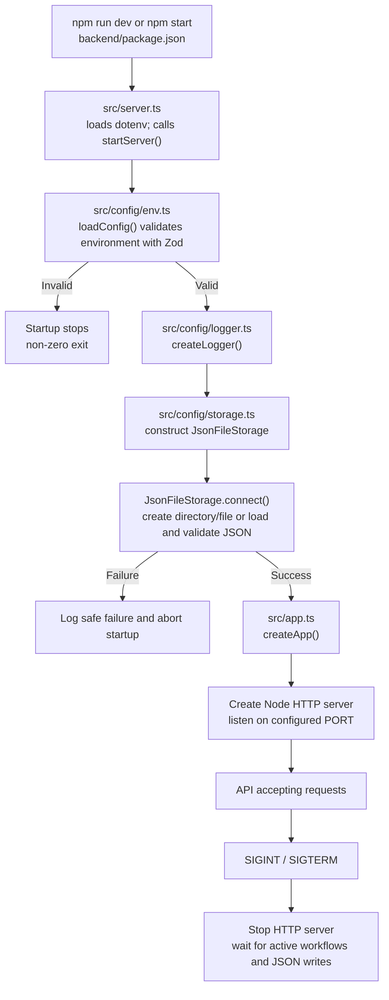
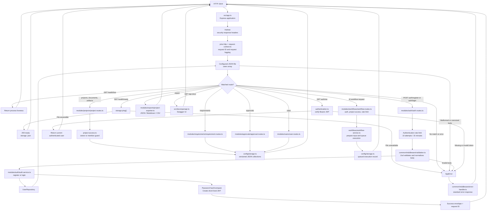
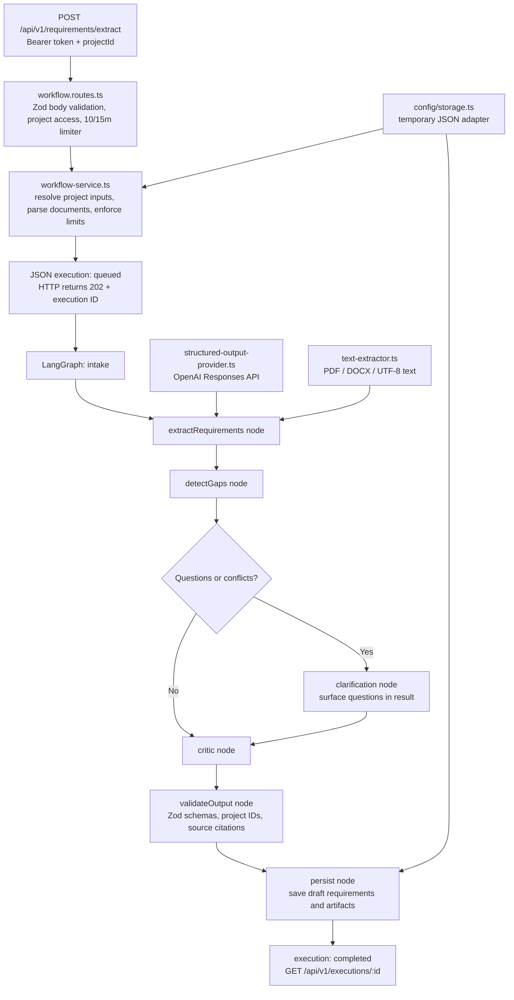

# Phase 3–5 Backend Walkthrough

This walkthrough follows the backend from process startup through the Phase 3 foundation, Phase 4 project/domain APIs, and Phase 5 LangGraph workflows. Persistence still uses a temporary single-process JSON file; MongoDB and durable job recovery are deferred.

## 1. Start here

The process entry point is [`src/server.ts`](src/server.ts). From the `backend` folder:

```powershell
npm run dev
```

For a compiled run:

```powershell
npm run build
npm start
```

Before starting, copy `.env.example` to `.env` and replace `JWT_SECRET` with a private random secret that is at least 32 characters long. The storage file is configured by `JSON_STORAGE_PATH` (default: `./data/ai-business-analyst.json`, relative to the backend working directory). No database service is required.

## 2. Startup path



### Startup details

1. `dotenv/config` loads local `.env` values.
2. `loadConfig()` checks required values and bounds such as the port, JSON file path, JWT secret, and token lifetime.
3. `createLogger()` creates the structured Pino logger with sensitive-field redaction.
4. `JsonFileStorage.connect()` creates the parent directory and initial versioned JSON file when missing, or loads and validates the existing file.
5. Only after storage initializes does `createApp()` assemble the HTTP application and the server begin listening.
6. User mutations are serialized and written through a temporary file followed by an atomic rename. Shutdown waits for queued writes.

## 3. HTTP request path



The normal API response shape is `{ success, data, requestId }`. Errors use `{ success: false, error: { code, message, details, requestId } }`. Request IDs are returned in both the response body and the `X-Request-Id` header.

## 4. Implemented HTTP APIs

| Method and path | What it does | Important behavior |
|---|---|---|
| `GET /api/v1/health/live` | Confirms the process is running. | Does not depend on storage. |
| `GET /api/v1/health/ready` | Checks whether JSON storage is usable. | Checks that the configured file is initialized and accessible; responds `503 SERVICE_UNAVAILABLE` otherwise. |
| `POST /api/v1/auth/register` | Creates a standard user account. | Requires valid email and a 12–128 character password. Always assigns `user`; never accepts elevated roles from the request. |
| `POST /api/v1/auth/login` | Checks credentials and issues an access token. | Returns a short-lived JWT; invalid credentials receive a generic `401`. |
| `GET /api/v1/auth/me` | Returns the current authenticated user. | Requires `Authorization: Bearer <token>`. |
| `POST /api/v1/projects` | Creates a project. | The authenticated user is the owner. |
| `GET /api/v1/projects?page=&limit=` | Lists accessible projects. | Pagination is validated; access is owner/member scoped. |
| `GET /api/v1/projects/:id` | Reads project data. | Inaccessible project IDs return `404`. |
| `PATCH /api/v1/projects/:id/members` | Replaces project members. | Owner-only; all member IDs must belong to registered users. |
| `POST /api/v1/projects/:id/documents` | Uploads a document. | PDF, DOCX, UTF-8 text; 5 MiB limit; metadata response omits file bytes. |
| `GET /api/v1/projects/:id/documents` | Lists document metadata. | Stored file bytes are not returned. |
| `POST /api/v1/projects/:id/requirements` | Creates a draft requirement. | Source documents must belong to the same project. |
| `GET /api/v1/projects/:id/requirements?page=&limit=` | Lists project requirements. | Paginated. |
| `PATCH /api/v1/requirements/:id` | Revises a requirement. | Saves the prior snapshot, increments version, and resets status to draft. |
| `GET /api/v1/requirements/:id/versions` | Lists requirement history. | Requires access to its project. |
| `GET /api/v1/artifacts/:id/versions?type=...` | Lists artifact version snapshots. | Requires a valid artifact type and project access. |
| `POST /api/v1/projects/:id/artifacts` | Creates a draft artifact. | Supports epic, story, acceptance criteria, business rule, risk, dependency, and implementation plan types. |
| `GET /api/v1/projects/:id/artifacts?page=&limit=` | Lists project artifacts. | Paginated. |
| `PATCH /api/v1/artifacts/:id` | Revises a generated artifact. | Saves the prior snapshot, increments the version, resets status to draft, and rejects edits while approval is pending. |
| `POST /api/v1/approvals` | Submits an artifact for review. | Artifact must belong to the declared project. |
| `PATCH /api/v1/approvals/:id` | Records a review decision. | Reviewer/admin only; self-review is rejected; decided approvals cannot be changed. |
| `PATCH /api/v1/users/:id/roles` | Assigns user roles. | Admin-only. Initial admin provisioning is out-of-band; changed roles take effect for newly issued tokens. |
| `GET /api/v1/projects/:id/export?format=json\|markdown\|csv` | Exports project data. | Document file bytes are excluded. |
| `POST /api/v1/requirements/analyze`, `/requirements/extract`, `/stories/generate`, `/acceptance-criteria/generate`, `/requirements/validate`, `/risks/analyze`, `/roadmap/generate` | Queues a Phase 5 workflow. | Returns `202` with an execution record; requires the selected provider's API key; missing key returns `503`. |
| `GET /api/v1/executions/:id` | Reads an execution record. | Returns `404` if no record exists or project access is denied. |
| `GET /api-docs` | Serves the Swagger UI. | Documents the implemented Phase 3–5 endpoints. |

The current endpoint contracts are also summarized in [`../docs/api/API-Specification.md`](../docs/api/API-Specification.md).

## 5. Phase 5 workflow execution



The analysis route also identifies stakeholders before extraction. Story generation, acceptance criteria, validation, risk analysis, and roadmap requests use their own graph task node and share output validation/persistence. Prompts are versioned in `src/workflows/prompts.ts`; source content is untrusted and is sent to OpenAI only when a configured workflow is invoked. OpenAI response storage is disabled. The in-process jobs are not crash-resumable; graceful shutdown waits for active jobs.

## 6. File map: where to read next

### Process and application composition

| File | Main responsibility |
|---|---|
| [`src/server.ts`](src/server.ts) | Actual process entry point. Loads config, initializes JSON storage, creates the app, listens on the port, and handles shutdown signals. |
| [`src/app.ts`](src/app.ts) | Creates the Express app and mounts health, auth, project, requirement, workflow, approval, user-role, and Swagger routes with shared middleware and errors. |
| [`package.json`](package.json) | Dependencies and the `dev`, `build`, `start`, `typecheck`, and `test` commands. |
| [`tsconfig.json`](tsconfig.json) | Strict TypeScript compiler settings and source/test inclusion. |
| [`README.md`](README.md) | Environment setup, run commands, and a short endpoint list. |

### Configuration and infrastructure

| File | Main responsibility |
|---|---|
| [`src/config/env.ts`](src/config/env.ts) | Defines and validates environment values with Zod; exports `loadConfig()`. |
| [`src/config/storage.ts`](src/config/storage.ts) | Owns JSON-file lifecycle, version-1 migration, validation, atomic writes, and user/project/document/requirement/artifact/approval/version/execution persistence. |
| [`src/config/logger.ts`](src/config/logger.ts) | Creates the structured Pino logger and redacts sensitive fields. |
| [`.env.example`](.env.example) | Lists local configuration names and safe placeholders. The JWT placeholder is deliberately invalid until replaced. |

### HTTP middleware and shared errors

| File | Main responsibility |
|---|---|
| [`src/common/middleware/request-context.ts`](src/common/middleware/request-context.ts) | Uses a valid supplied `X-Request-Id` or generates one, then adds it to the response header. |
| [`src/common/middleware/validation.ts`](src/common/middleware/validation.ts) | `validateBody(schema)` validates a request body and returns standard validation errors. |
| [`src/common/middleware/authentication.ts`](src/common/middleware/authentication.ts) | `authenticate(secret)` verifies bearer JWTs; `requireRoles(...)` enforces roles. |
| [`src/common/middleware/project-access.ts`](src/common/middleware/project-access.ts) | `requireProjectAccess(repository)` checks project ownership/membership and returns not-found for inaccessible projects. |
| [`src/common/middleware/error-handler.ts`](src/common/middleware/error-handler.ts) | Converts application, malformed-JSON, oversized-body, and unknown errors into the common error envelope; also defines not-found handling. |
| [`src/common/errors/app-error.ts`](src/common/errors/app-error.ts) | Shared `AppError` type carrying status, code, message, and validation details. |
| [`src/common/types/express.d.ts`](src/common/types/express.d.ts) | Adds the request ID and authenticated-user fields to Express request types. |

### Authentication module and API description

| File | Main responsibility |
|---|---|
| [`src/modules/auth/auth.routes.ts`](src/modules/auth/auth.routes.ts) | Defines `POST /register`, `POST /login`, and `GET /me`; applies rate limiting and body validation. |
| [`src/modules/auth/auth.service.ts`](src/modules/auth/auth.service.ts) | Normalizes email, hashes/checks passwords, prevents duplicate registration, and issues JWTs. |
| [`src/modules/auth/user.repository.ts`](src/modules/auth/user.repository.ts) | Defines the user record and repository contract used by the auth service. |
| [`src/modules/domain/domain.schemas.ts`](src/modules/domain/domain.schemas.ts) | Defines Zod persistence and request schemas for projects and domain records. |
| [`src/modules/projects/project.routes.ts`](src/modules/projects/project.routes.ts) | Project CRUD, membership management, document upload/list, artifact create/list, and export routes. |
| [`src/modules/requirements/requirement.routes.ts`](src/modules/requirements/requirement.routes.ts) | Draft requirement creation/list/edit and version-history routes. |
| [`src/modules/approvals/approval.routes.ts`](src/modules/approvals/approval.routes.ts) | Approval submission and reviewer decision/state transitions. |
| [`src/modules/users/user.routes.ts`](src/modules/users/user.routes.ts) | Admin-only role assignment. |
| [`src/modules/workflows/workflow.routes.ts`](src/modules/workflows/workflow.routes.ts) | Authenticated, rate-limited workflow submission and project-scoped execution lookup. |
| [`src/workflows/workflow-service.ts`](src/workflows/workflow-service.ts) | Validates project inputs, parses selected documents, persists queued jobs, tracks nodes, and drains on shutdown. |
| [`src/workflows/workflow-graph.ts`](src/workflows/workflow-graph.ts) | Typed LangGraph nodes for extraction, gap/clarification routing, critic, generation, schema validation, and draft persistence. |
| [`src/workflows/prompts.ts`](src/workflows/prompts.ts) | Versioned task prompts and untrusted-content instructions. |
| [`src/workflows/workflow.schemas.ts`](src/workflows/workflow.schemas.ts) | Zod schemas for structured model outputs and workflow results. |
| [`src/integrations/llm/structured-output-provider.ts`](src/integrations/llm/structured-output-provider.ts) | OpenAI Responses structured-output adapter with timeout, bounded retry, and response storage disabled. |
| [`src/integrations/documents/text-extractor.ts`](src/integrations/documents/text-extractor.ts) | Extracts text from PDF, DOCX, and UTF-8 text documents. |
| [`src/modules/exports/project-exporter.ts`](src/modules/exports/project-exporter.ts) | Renders JSON, Markdown, and CSV exports; escapes Markdown and CSV values. |
| [`src/docs/openapi.ts`](src/docs/openapi.ts) | OpenAPI 3.1 document served by Swagger UI. |

## 7. Environment values

| Name | Required/default | Purpose |
|---|---|---|
| `NODE_ENV` | Defaults to `development` | Runtime environment (`development`, `test`, or `production`). |
| `PORT` | Defaults to `3000` | HTTP listening port. |
| `JSON_STORAGE_PATH` | Defaults to `./data/ai-business-analyst.json` | JSON file path; relative paths resolve from the backend working directory. |
| `JWT_SECRET` | Required, minimum 32 characters | Signs and verifies access tokens. |
| `JWT_TTL_SECONDS` | Defaults to `900`; allowed `60–86400` | Access-token lifetime. |
| `LOG_LEVEL` | Defaults to `info` | Pino log level. |
| `LLM_PROVIDER` | Defaults to `openai` | Selects `openai` or `groq`. |
| `OPENAI_API_KEY` | Optional | Enables OpenAI workflow calls; never commit the real key. |
| `OPENAI_MODEL` | Defaults to `gpt-6-luna` | OpenAI model for structured workflow output. |
| `GROQ_API_KEY` | Optional | Enables Groq workflow calls; never commit the real key. |
| `GROQ_MODEL` | Defaults to `openai/gpt-oss-120b` | Groq model for structured workflow output. |

## 8. Authentication and project access in plain language

- Registration stores a bcryptjs password hash (cost factor 12), not the raw password.
- New accounts receive only the `user` role. Elevated roles are not self-assigned through registration.
- Login issues a JWT whose subject is the user's generated string ID and whose claims include the user's roles.
- `authenticate()` verifies the token before setting `request.user`.
- `requireRoles()` can guard routes that require a specific role.
- `requireProjectAccess()` asks the JSON-backed project repository whether the authenticated user is the project owner or a member.
- Project routes and workflow routes enforce project owner/member access.

## 9. Tests and current boundary

Tests live under [`tests/`](tests/). They exercise environment validation, JSON persistence/reload, write serialization, health/readiness responses, request validation, registration/login/token behavior, role checks, and project-access middleware. Storage tests use isolated temporary files.

Run the checks from `backend`:

```powershell
npm run typecheck
npm test
```

### Implemented in Phases 3–5

- Express/TypeScript foundation and configuration
- Versioned JSON storage initialization/migration, validation, atomic writes, and readiness check
- Request IDs, structured logging, centralized errors, and Zod body validation
- JWT authentication, password hashing, role checks, and project-access guard
- Project/document/requirement/artifact/approval/version/execution records and APIs
- Role assignment, project membership, paginated reads, exports, and upload validation
- Rate limiting, Helmet security headers, health routes, Swagger UI, and API tests
- Async LangGraph jobs, OpenAI adapter, document text extraction, structured output validation, source citation checks, and node-level execution status

### Deferred

- Durable queue, cross-process execution, crash recovery, and resumable graph checkpoints
- MongoDB adapter and migration (deferred; JSON remains temporary until approved)
- Docker setup (Phase 8)

Phase 5 is complete at the current scope. Stop here and request explicit approval before starting Phase 6.
