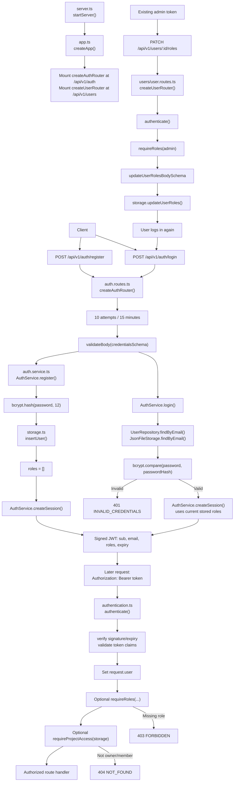

# Learning Roadmap: Login, Roles, and Authorization

This guide follows the authentication path through the backend in small chunks. Start at the HTTP entry point, then trace registration, role assignment, login, and authorization on later requests.

## What you will understand

By the end, you should be able to explain:

1. How `POST /api/v1/auth/register` creates a user with no assigned roles.
2. How an administrator changes a user's role.
3. How `POST /api/v1/auth/login` verifies credentials and creates a JWT.
4. How later requests authenticate that JWT.
5. How role permissions and project ownership/membership are checked separately.

## The important distinction

- **Authentication** answers: "Who is making this request?" Login verifies credentials once and issues a token. The `authenticate()` middleware verifies that token on each protected request.
- **Authorization** answers: "May this authenticated user do this?" `requireRoles()` checks a role; `requireProjectAccess()` checks project ownership or membership.
- A new account starts with no roles and has no application permissions until an administrator assigns one. A login copies the user's current roles into a new token. Role changes invalidate existing tokens, so the user must log in again to receive updated roles.
- The `project_owner` user role is not the same check as owning a particular project. Project access is determined from each project's `ownerUserId` and `members`.

## End-to-end architecture flow



## Endpoint map

| Endpoint | Purpose | Authorization |
|---|---|---|
| `POST /api/v1/auth/register` | Creates a roleless account and returns a limited session. | Public, rate-limited; no application permissions until an admin assigns a role. |
| `POST /api/v1/auth/login` | Verifies credentials and returns a fresh access token. | Public, rate-limited. |
| `GET /api/v1/auth/me` | Returns the authenticated user's token claims. | Requires a valid bearer token. |
| `PATCH /api/v1/users/:id/roles` | Assigns roles or clears them to return an account to pending access. | Requires `admin`; self-role changes are rejected. |
| `GET /api/v1/projects/:id` | Example of project-scoped access. | Requires a valid token and project owner/member access. |
| `PATCH /api/v1/approvals/:id` | Example of a role-protected action. | Requires `reviewer` or `admin`, plus project access and no self-review. |

Use the `/api/v1` prefix with the endpoints in the table. The app mounts the authentication router at `/api/v1/auth` and the user-role router at `/api/v1/users`.

## Chunk 0: Find the application entry point

**Goal:** Learn how requests reach the routers.

Read:

1. [`server.ts`](../../backend/src/server.ts) - `startServer()` loads configuration, initializes JSON storage, creates the app, and listens.
2. [`app.ts`](../../backend/src/app.ts) - `createApp()` installs shared middleware and mounts `createAuthRouter()` and `createUserRouter()`.

Follow these lines conceptually:

```text
startServer()
  -> createApp(...)
    -> app.use("/api/v1/auth", createAuthRouter(...))
    -> app.use("/api/v1/users", createUserRouter(...))
```

**Check yourself:** Why does `auth.routes.ts` define `"/login"` rather than the full `"/api/v1/auth/login"` path? The router prefix is supplied by `createApp()`.

## Chunk 1: Trace the registration route

**Goal:** See how request validation leads to a service call.

Read [`auth.routes.ts`](../../backend/src/modules/auth/auth.routes.ts), especially:

- `credentialsSchema` - trims and validates email; password must be 12-128 characters.
- `createAuthRouter()` - creates the router, shared limiter, and endpoints.
- `router.post("/register", ...)` - runs the limiter, `validateBody(credentialsSchema)`, then `service.register(...)`.

Request shape:

```http
POST /api/v1/auth/register
Content-Type: application/json

{"email":"learner@example.com","password":"<12-to-128-character-password>"}
```

Successful registration returns `201` with `{ success, data: { accessToken, user }, requestId }`. The response user has an empty `roles` array and contains no `passwordHash`; the frontend directs the user to the pending-access screen.

**Check yourself:** What happens before the service is called if the email or password is invalid? Where does the invalid input become the standard API error?

## Chunk 2: Follow pending-role persistence

**Goal:** Understand why a public registration cannot create an administrator.

Read [`auth.service.ts`](../../backend/src/modules/auth/auth.service.ts), `AuthService.register()`:

1. Trims and lowercases the email.
2. Checks for a duplicate account with `users.findByEmail()`.
3. Hashes the password using `bcrypt.hash(password, 12)`.
4. Calls `users.insertUser(...)` with `roles: []`.
5. Creates a limited session; permission-protected routes remain unavailable until an administrator assigns a role.

Then read:

- [`user.repository.ts`](../../backend/src/modules/auth/user.repository.ts) - `UserRepository` defines `findByEmail`, `insertUser`, and `updateUserRoles`; it is the storage boundary, not the JSON implementation.
- [`storage.ts`](../../backend/src/config/storage.ts) - `JsonFileStorage.insertUser()` generates the user ID, checks duplicate email again, and persists the record. `JsonFileStorage.findByEmail()` retrieves the stored record.

`userRoles` in `user.repository.ts` defines the supported application roles. An empty role array is the pending-assignment state, not an application role.

**Check yourself:** Why is the password hash stored rather than the original password? Why does registration accept no role input and leave role assignment to an administrator?

## Chunk 3: Follow the separate admin role-assignment path

**Goal:** Understand who can grant elevated roles and what gets validated.

Read [`user.routes.ts`](../../backend/src/modules/users/user.routes.ts), `createUserRouter()`:

1. `router.use(authenticate(jwtSecret))` requires a valid token for the router.
2. `requireRoles("admin")` allows only an admin token through the role endpoint.
3. `validateBody(updateUserRolesBodySchema)` validates the requested roles.
4. The handler rejects changing the administrator's own roles.
5. `storage.updateUserRoles(userId, roles)` updates the stored user.

Read [`domain.schemas.ts`](../../backend/src/modules/domain/domain.schemas.ts), `updateUserRolesBodySchema`. It accepts supported roles, requires at least one, and rejects duplicate roles.

Request shape:

```http
PATCH /api/v1/users/<target-user-id>/roles
Authorization: Bearer <admin-access-token>
Content-Type: application/json

{"roles":["user","reviewer"]}
```

`JsonFileStorage.updateUserRoles()` is in [`storage.ts`](../../backend/src/config/storage.ts). It updates the stored roles and `updatedAt`. The initial admin is provisioned out-of-band in the temporary JSON store; there is no public endpoint that makes the first user an admin.

**Important:** The role update changes storage, not tokens already issued to that user. The user must log in again to receive a token with the new role claims.

## Chunk 4: Trace login and JWT creation

**Goal:** Follow a valid credential pair to a signed token.

Start at `router.post("/login", ...)` in [`auth.routes.ts`](../../backend/src/modules/auth/auth.routes.ts). It uses the same limiter and credentials schema as registration, then calls `AuthService.login()`.

In [`auth.service.ts`](../../backend/src/modules/auth/auth.service.ts), `AuthService.login()`:

1. Normalizes the email and calls `users.findByEmail()`.
2. Calls `bcrypt.compare()` to compare the submitted password with the stored hash.
3. Returns the same `401 INVALID_CREDENTIALS` message when the account is missing or the password is wrong.
4. Calls `createSession(user)` only after the credentials match.

`AuthService.createSession()` uses `jsonwebtoken.sign()` to create a token with:

- `sub`: user ID (the JWT subject)
- `email`: normalized email
- `roles`: the user's current stored roles
- `exp`: generated from `JWT_TTL_SECONDS`

The JWT is signed, not encrypted. Its claims can be decoded by a token holder, so do not put passwords, secrets, or other sensitive data in it.

The secret and TTL come from `loadConfig()` in [`env.ts`](../../backend/src/config/env.ts). The default TTL is 900 seconds (15 minutes); the allowed range is 60-86400 seconds. The signing secret must be at least 32 characters.

**Check yourself:** Why does the API return a generic invalid-credentials message for both a missing user and a wrong password?

## Chunk 5: Follow authentication on a later request

**Goal:** Understand what the server does with a bearer token after login.

Read [`authentication.ts`](../../backend/src/common/middleware/authentication.ts), `authenticate(jwtSecret)`:

1. Reads the `Authorization` header and extracts `Bearer <token>`.
2. Calls `jsonwebtoken.verify(token, jwtSecret)`, which checks the signature and expiry.
3. Validates the decoded claims with `tokenClaimsSchema`.
4. Sets `request.user` to `{ id, email, roles }`.
5. Calls `next()` to continue to the route.

Missing, expired, malformed, or invalid tokens produce a `401`. The request type is extended in [`express.d.ts`](../../backend/src/common/types/express.d.ts).

Try:

```http
GET /api/v1/auth/me
Authorization: Bearer <access-token>
```

The route in [`auth.routes.ts`](../../backend/src/modules/auth/auth.routes.ts) uses `authenticate()` and returns `request.user`. It reads the token claims; it does not reload the user from storage on every `/me` request.

## Chunk 6: Separate role authorization from project authorization

**Goal:** Learn why a valid token may still receive `403` or `404`.

### Role authorization

`requireRoles(...roles)` in [`authentication.ts`](../../backend/src/common/middleware/authentication.ts) checks that `request.user` exists and that the token contains at least one allowed role. For example:

- `PATCH /api/v1/users/:id/roles` requires `admin`.
- `PATCH /api/v1/approvals/:id` requires `reviewer` or `admin`.

If authentication succeeds but no allowed role is present, the result is `403 FORBIDDEN`.

### Project authorization

`requireProjectAccess(storage)` in [`project-access.ts`](../../backend/src/common/middleware/project-access.ts) finds a project ID in the route parameter or request body, then calls `userCanAccessProject(projectId, userId)`.

`JsonFileStorage.userCanAccessProject()` in [`storage.ts`](../../backend/src/config/storage.ts) permits the project owner or a listed member. It does not grant access just because a token has the `admin` or `project_owner` role. Inaccessible projects return `404 NOT_FOUND` to avoid revealing whether the project exists.

**Check yourself:** A user has a valid token and the `reviewer` role but is not a member of the approval's project. Which checks pass, and what should the API return?

## Chunk 7: Follow errors and tests

**Goal:** Confirm expected behavior from the API boundary.

Read:

- [`error-handler.ts`](../../backend/src/common/middleware/error-handler.ts) - maps `AppError` to the common error envelope.
- [`app.test.ts`](../../backend/tests/app.test.ts) - covers registration, login, `/auth/me`, role assignment, and approval transitions.
- [`security-middleware.test.ts`](../../backend/tests/security-middleware.test.ts) - covers `requireRoles()` and project-access behavior.
- [`openapi.ts`](../../backend/src/docs/openapi.ts) - documents `/auth/register`, `/auth/login`, `/auth/me`, and `/users/{id}/roles`.

Useful status codes to recognize:

| Status | Meaning in this flow |
|---|---|
| `201` | Registration created an account. |
| `200` | Login, `/auth/me`, or role update succeeded. |
| `400` | Request data invalid, or administrator attempted to change their own roles. |
| `401` | Credentials invalid, token missing, or token invalid/expired. |
| `403` | Token is valid but does not contain a required role. |
| `404` | User/project/resource does not exist or is intentionally concealed by an access check. |
| `409` | Registration email is already in use. |
| `429` | Authentication attempt rate limit reached (10 attempts per 15 minutes). |

## Suggested reading order

1. `server.ts` -> `app.ts`
2. `auth.routes.ts` -> `auth.service.ts`
3. `user.repository.ts` -> `storage.ts`
4. `user.routes.ts` -> `domain.schemas.ts`
5. `authentication.ts` -> `current-user.ts`
6. `project-access.ts` -> project-scoped routes
7. `error-handler.ts` -> the related tests -> `openapi.ts`

After each chunk, explain the flow aloud without looking at the code. Then reopen the named file and verify your explanation against the function and endpoint listed above.
